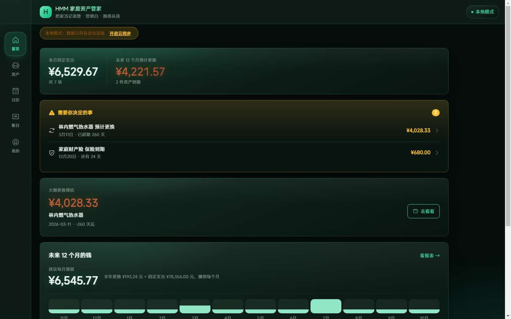
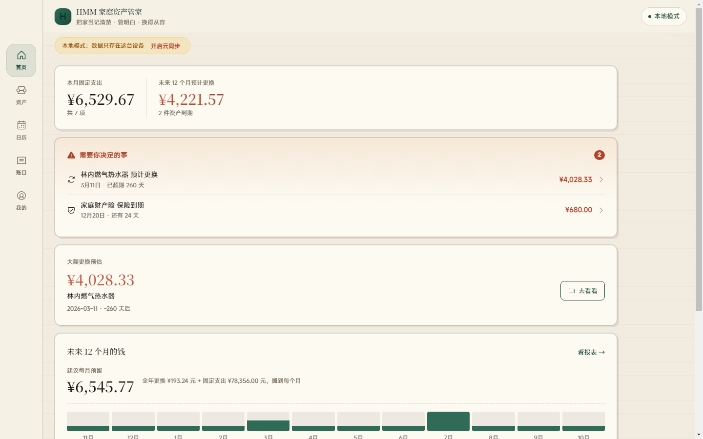
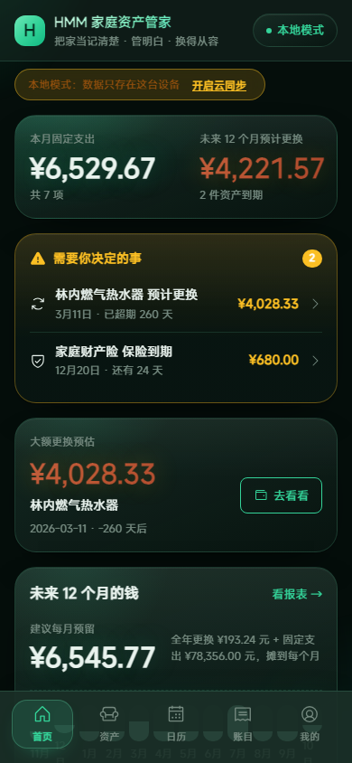

# HMM · 家庭资产管家

[](https://github.com/leonz973/hmm/actions/workflows/ci.yml)
[](https://github.com/leonz973/hmm/actions/workflows/docker.yml)
[](LICENSE)

**把家里的东西记清楚，把要花的钱算明白。**

冰箱什么时候过保、洗衣机还能用几年、净水器滤芯该换了、下个月物业费和车险要扣多少——
这些事散在发票、保修卡、微信记录和自己的记忆里。HMM 把它们收进一个地方，并且在**到期之前**告诉你：
「这件东西大概该换了，按今天的价格要花 ¥4,028」。

| 深色 · 墨绿高光 | 浅色 · 纸感编辑部 |
| --- | --- |
|  |  |

<p align="center">
  
</p>

---

## 目录

- [它解决什么问题](#它解决什么问题)
- [功能](#功能)
- [快速开始（Docker，两条命令）](#快速开始docker两条命令)
- [本地开发](#本地开发)
- [配置项](#配置项)
- [部署到自己的服务器](#部署到自己的服务器)
- [数据、备份与升级](#数据备份与升级)
- [测试与持续集成](#测试与持续集成)
- [常见问题](#常见问题)
- [技术架构](#技术架构)
- [路线图](#路线图)
- [License](#license)

---

## 它解决什么问题

家里的耐用品有一个共同点：**买的时候一次性付钱，坏的时候又是一次性付钱**，而中间那几年你完全想不起它。

- 冰箱 2019 年买的，质保 3 年——等它坏了你才发现早过保了，维修费全自付；
- 空调用了 6 年，某天突然不制冷，几千块只能临时凑；
- 净水器滤芯、油烟机清洗、地暖保养，全靠「想起来才做」；
- 物业费、车险、宽带续费、会员自动续费，每个月从卡里悄悄划走。

HMM 做的事情很朴素：**把这些一次性支出变成可预测的月度数字**。

1. 录入资产时填「购买日期 + 价格 + 质保月数 + 预计寿命 + 使用强度」，系统算出质保到期日、预计换新日、当前残值；
2. 换新金额按品类通胀率折算到今天，首页告诉你「未来 12 个月预计要花 ¥X，建议每月预留 ¥Y」；
3. 质保、换新、保养、保险到期前 N 天自动提醒（应用内 + 邮件）；
4. 固定支出和账单单独记账，现金流图和资产换新叠在一起看，钱从哪个月开始紧张一目了然。

不登录也能用（数据只存在浏览器里，适合先试手感）；登录后是云同步，一家人共享同一个「家」。

## 功能

### 资产台账

- 记录：名称、品类、房间、购买日期、价格、质保月数、预计寿命、使用强度（轻/中/重）、备注、发票
- 自动计算：质保到期日、预计换新日、剩余天数、寿命进度条、当前残值、按通胀折算的换新金额
- 内置 6 个品类的默认寿命与质保（大家电 / 小家电 / 家具 / 厨卫 / 耗材 / 工具），选品类自动带出，可改
- 使用强度会缩放寿命：轻用 ×1.2、正常 ×1.0、重用 ×0.8
- **以旧换新**：旧件点「这件已经换新了」，登记新购件，旧件自动留档（历史发票、保养记录都还挂在旧件上，不丢）

### 保养计划

- 给一件资产挂周期性事项：换滤芯、清洗滤网、深度清洁、检修保养（也可自定义周期）
- 按周期算下次到期日，点「✓ 做完了」按完成日自动顺延
- 到期后进入提醒与首页「需要你决定的事」

### 到期提醒

- 每天 06:00（Asia/Shanghai）扫一遍：质保到期、预计换新、保养到期、保险到期
- 合并成一封邮件发出；同类提醒按 `类型 + 对象 + 日期` 去重，不会重复轰炸
- 提前天数可调（默认质保 60 天、换新 90 天）；过期后 30 天内仍会提醒一次
- 没配 SMTP 时不报错，把邮件写成 `.mail-out/*.html` 预览文件，方便先看效果
- 每次运行都留一条运行日志（发现几条、新建几条、发没发出去、失败原因）

### 账目

- **固定支出**：房租、物业、宽带、车险、会员……支持月/季/半年/年四种周期，自动滚到下一个扣款日，算出月均与年化
- **账单**：水、电、燃气、物业等按月份记，标记已缴/未缴，逾期标红，看最近 12 个月趋势
- **发票存档**：商家、内容、金额、日期、类型、发票号、PDF/图片附件；一张发票可以关联多件资产，资产详情页能看到自己的凭证

### 现金流与报表

- 首页「未来 12 个月的钱」：每月「换新预估 + 固定支出」堆叠柱，给出**建议每月预留**
- 统计报表：今年支出构成、资产按品类/房间分布、折旧与残值、未来三年资金压力

### 目标与保险

- **储蓄目标**：目标金额、已存金额、目标日期，自动算进度、还差多少、每月约存多少，支持「存一笔」
- **保险台账**：险种、公司、保额、保费、缴费周期、起止日期，到期前提醒

### 家庭共享

- 注册即建家；8 位邀请码 72 小时有效，家人输入即可加入同一个家
- 三种角色：户主（可改名/改提醒设置）、管理成员、普通成员
- 所有数据按家庭隔离，接口层强制校验

### 手机端

- PWA：可加到手机桌面，独立窗口打开，带离线壳
- 深色「墨绿高光」/ 浅色「纸感编辑部」两套主题，跟随设置切换
- 刘海屏安全区、防 iOS 输入框聚焦放大、真机手势区适配

### 备份

- 全量 JSON 导出 / 导入（合并去重），云端模式下导入会直接写进服务器
- 资产 CSV 导出（带 BOM，Excel 直接打开不乱码）

## 快速开始（Docker，两条命令）

需要一台装了 Docker 的机器（Windows / macOS / Linux / NAS 都行）。

```bash
docker run -d --name hmm \
  -p 3000:3000 \
  -v hmm_data:/data \
  -e JWT_SECRET="$(openssl rand -hex 32)" \
  leonz973/hmm:latest
```

打开 <http://localhost:3000>，注册一个账号就能用。

- 前端页面和 API 在**同一个端口**，不需要额外的 Nginx/Caddy
- 数据（SQLite 数据库 + 附件）全部在 `hmm_data` 卷里，删容器不丢数据
- Windows PowerShell 里 `$(openssl rand -hex 32)` 换成随便一串 32 位以上随机字符即可

不想要 Docker，也可以只跑一个二进制组合（见「本地开发」）。

## 本地开发

### 前置

- Node.js ≥ 20（开发用 22/24 均可）
- npm ≥ 10（项目用 **npm workspaces**，不用 pnpm/yarn）

### 跑起来

```bash
git clone https://github.com/leonz973/hmm.git
cd hmm

# 1. 装依赖
npm install

# 2. 配置后端环境变量
cp apps/api/.env.example apps/api/.env
#   至少改 JWT_SECRET；数据库默认 file:./dev.db，附件默认 ./storage

# 3. 建库（必须在 apps/api 目录下跑，DATABASE_URL 在那里）
cd apps/api && npx prisma db push && cd ../..

# 4. 起开发服务（前端 5173 + 后端 3000，vite 已配 /api 代理）
npm run dev
```

- 前端：<http://127.0.0.1:5173>
- 后端健康检查：<http://127.0.0.1:3000/api/v1/health>
- 产品需求：`PRD.md`；设计令牌：`docs/DESIGN.md`；架构与接口：`docs/ARCHITECTURE.md`

### 想要有数据的样子

```bash
npm run seed:demo
```

会建一个演示家庭：8 件资产、3 条保养计划、7 项固定支出、8 张水电燃气账单、3 张发票，并故意留了几条「5 天后到期」的样本。

账号 `demo@hmm.local` / 密码 `hmm12345`（仅本地演示，别用在线上）。

### 常用命令

| 命令 | 作用 |
| --- | --- |
| `npm run dev` | 前端 + 后端一起起（concurrently） |
| `npm run dev:web` / `npm run dev:api` | 只起其中一个 |
| `npm run build` | 全量构建：shared → web → api |
| `npm test` | 跑前后端单测（vitest） |
| `npm run typecheck` | 类型检查 |
| `npm run seed:demo` | 灌演示数据 |
| `cd apps/api && npx prisma studio` | 打开数据库可视化 |

> 受限环境（比如某些沙箱）里 `npm install` 可能因 postinstall 被拦，可加 `--ignore-scripts`；
> 项目本身不依赖任何 postinstall 构建产物。

## 配置项

后端从 `apps/api/.env`（本地）或容器环境变量读取。

| 变量 | 默认值 | 说明 |
| --- | --- | --- |
| `PORT` | `3000` | 监听端口 |
| `DATABASE_URL` | `file:/data/hmm.db`（镜像内） | SQLite 文件位置 |
| `JWT_SECRET` | 无 | **必填**，随机 32 字节以上；泄露等于别人能伪造登录 |
| `JWT_ACCESS_TTL` | `15m` | 访问令牌有效期 |
| `JWT_REFRESH_TTL` | `30d` | 刷新令牌有效期 |
| `STORAGE_DIR` | `/data/storage` | 附件落盘目录 |
| `APP_URL` | `http://localhost:3000` | 站点地址，用于邮件里的链接 |
| `TZ` | `Asia/Shanghai` | 时区，影响「今天」的判定与提醒时间 |
| `SERVE_WEB` | 镜像内 `1` | 设为 `1` 时同端口提供前端静态资源 |
| `WEB_DIST` | `/app/apps/web/dist` | 前端产物目录 |
| `SMTP_HOST` / `SMTP_PORT` / `SMTP_USER` / `SMTP_PASS` | 空 | 邮件提醒；QQ/163 邮箱填**授权码**不是登录密码 |
| `SMTP_SECURE` | `true` | 465 端口用 `true`，587 用 `false` |
| `SMTP_FROM` | 同 `SMTP_USER` | 发件人显示名 |
| `MAIL_PREVIEW_DIR` | `<cwd>/.mail-out` | 未配 SMTP 时邮件写这里 |

提醒的提前天数、是否发邮件在页面「设置 → 提醒设置」里改（存数据库，按家庭生效）。

## 部署到自己的服务器

### 方式一：单镜像（推荐，最简单）

```bash
docker run -d --name hmm \
  --restart unless-stopped \
  -p 80:3000 \
  -v /srv/hmm:/data \
  -e JWT_SECRET="换成你自己的随机串" \
  -e APP_URL="http://你的服务器IP" \
  leonz973/hmm:latest
```

浏览器打开 `http://服务器IP` 即可。想换端口就改 `-p 8080:3000`。

### 方式二：docker compose（带 Caddy、自动 HTTPS）

仓库里的 `deploy/` 目录是多容器方案：Caddy（自动申请证书）+ 前端静态 + API。

```bash
git clone https://github.com/leonz973/hmm.git && cd hmm
cp deploy/.env.example deploy/.env
# 编辑 deploy/.env：DOMAIN（有域名填域名，没域名填 :80）、JWT_SECRET、SMTP
docker compose -f deploy/docker-compose.yml --env-file deploy/.env up -d --build
```

有域名且解析到这台机器时，Caddy 会自动签 Let's Encrypt 证书；只有 IP 时用 `DOMAIN=:80` 走 HTTP。

### 方式三：已有 Nginx/宝塔

把单镜像跑在 `3000`，然后反代：

```nginx
location / {
    proxy_pass http://127.0.0.1:3000;
    proxy_set_header Host $host;
    proxy_set_header X-Real-IP $remote_addr;
    proxy_set_header X-Forwarded-For $proxy_add_x_forwarded_for;
    proxy_set_header X-Forwarded-Proto $scheme;
    client_max_body_size 30m;   # 发票附件上传
}
```

### 反向代理/域名注意事项

- **HTTPS 才能装 PWA、才能用浏览器推送**；只有 IP 时页面能用，但「添加到主屏幕」和推送不可用
- 附件上限 25MB，反代要放开 `client_max_body_size`
- 时区建议设 `TZ=Asia/Shanghai`，否则「今天到期」会按 UTC 算，差 8 小时

## 数据、备份与升级

数据只有两样：SQLite 数据库文件 + 附件目录，都在镜像的 `/data` 下。

```bash
# 备份（把卷打成一个 tar.gz，建议加进 crontab 每天跑）
docker run --rm -v hmm_data:/data -v "$PWD":/backup alpine \
  tar czf /backup/hmm-$(date +%F).tar.gz -C /data .

# 恢复（先停容器，恢复后再启动）
docker stop hmm
docker run --rm -v hmm_data:/data -v "$PWD":/backup alpine \
  sh -c "rm -rf /data/* && tar xzf /backup/hmm-2026-11-26.tar.gz -C /data"
docker start hmm

# 升级
docker pull leonz973/hmm:latest
docker rm -f hmm   # 卷还在，数据不丢
# 再执行一次上面的 docker run
```

应用启动时会自动执行 `prisma db push` 补表结构，小版本升级不用手动迁移；
跨大版本升级前建议先备份。

## 测试与持续集成

```bash
npm test          # 前端 39 项 + 后端 4 项
npm run build     # 等价于 CI 的构建步骤
```

- `CI`（`.github/workflows/ci.yml`）：每次 push / PR 跑安装 → Prisma generate → 构建 → 单测
- `Docker`（`.github/workflows/docker.yml`）：push 到 main 或打 `v*` tag 时构建 amd64/arm64 双架构镜像并推 Docker Hub

镜像发布需要在仓库 Secrets 里配 `DOCKERHUB_USERNAME` 与 `DOCKERHUB_TOKEN`（Docker Hub → Account settings → Security → New access token，权限 Read & Write）。没配也能跑，只是不推送。

## 常见问题

**Q：和 Excel / 记账 App 有什么区别？**
记账 App 记的是「已经花掉的钱」，HMM 算的是「**还没花但一定会花的钱**」——按资产寿命、质保、固定支出往前推，这是它存在的理由。

**Q：数据安全吗？**
数据全在你自己的服务器/电脑上，没有第三方服务。密码用 argon2id 哈希，附件存在本地磁盘，JWT 短期有效 + refresh 轮换。默认没有对外开放的注册验证，公网部署建议加一层反代白名单或改成邀请制。

**Q：为什么用 SQLite 而不是 Postgres？**
家用规模（几千条记录、一两台设备）SQLite 足够，省掉一个数据库容器的运维成本，备份就是拷一个文件。代码用 Prisma，需要时可以换 Postgres（改 `datasource` 和 `DATABASE_URL`）。

**Q：邮件发不出去？**
QQ/163 要用「授权码」而不是登录密码，且要在邮箱设置里开启 SMTP 服务；465 端口配 `SMTP_SECURE=true`。没配也能用，邮件会写成 `.mail-out/*.html`。

**Q：手机上装不了 PWA？**
需要 HTTPS（或 localhost）。HTTP + IP 访问时浏览器不给安装权限。

**Q：忘记密码怎么办？**
当前版本没有自助找回（需要 SMTP + 域名），可以在服务器上直接改库或用 `prisma studio` 重置。

## 技术架构

```
apps/web          Vue 3 + Vite + TypeScript + Pinia（PWA，6 个页面）
apps/api          NestJS 10 + Prisma 6 + SQLite（auth / households / assets /
                  fixed-expenses / bills / invoices / attachments / reminders /
                  maintenance / saving-goals / insurance）
packages/shared   前后端共用：金额换算、质保/换新日期、品类默认值
deploy            Dockerfile、docker-compose、Caddyfile、备份脚本
docs              DESIGN.md（设计令牌）、ARCHITECTURE.md（架构与接口）
PRD.md            产品需求文档
```

- 金额一律以**分**（整数）存储，避免浮点误差；日期用 `YYYY-MM-DD` 字符串，避免时区漂移
- 认证：JWT（15 分钟）+ refresh token（30 天，轮换、只存哈希）
- 多租户：所有查询带 `householdId`，请求头 `x-household-id` 切换当前家庭
- 附件：`POST /api/v1/attachments` 落盘 + 元数据入库，下载走鉴权后的流式响应

更细的接口清单和流程见 [`docs/ARCHITECTURE.md`](docs/ARCHITECTURE.md)。

## 路线图

- [x] 资产台账、质保与换新预估
- [x] 固定支出、账单、发票与附件
- [x] 到期提醒引擎（应用内 + 邮件）
- [x] 保养计划、以旧换新、目标与保险
- [x] 统计报表、现金流预测、PWA
- [ ] 真实 SMTP 投递验证（等授权码）
- [ ] Web Push（需要域名 + HTTPS）
- [ ] 发票 OCR 自动识别（V1）
- [ ] 能耗对标、购物决策建议（V2）

## License

[MIT](LICENSE) © 2026 leonz973
